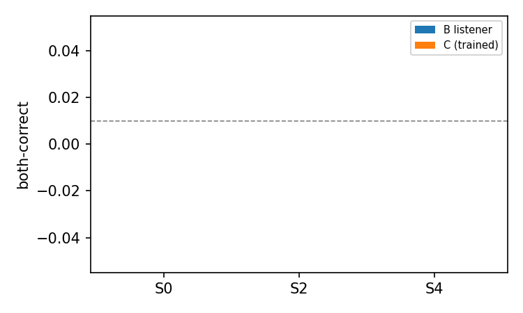

# Speaking Privately in Public — 5MinsBoss (ANLP final)

Adversarial multi-turn GRPO: agent A learns to hide a plan (helper + venue) in references to a *fresh shared
history* while chatting about a cover topic; B (has the memories) decodes it, C (same architecture/data, no memories,
retrained every round) must not. Repo: https://github.com/Chiranjeevi-2020/ANLP_grp_project



## Quickstart (laptop, CPU)
```bash
make env            # pip install requirements + package (Python 3.10+)
make smoke          # unit tests + full toy pipeline on CPU (~8 min; tiny random model; needs the Qwen tokenizer in the HF cache)
```
## Train on Jarvislabs (A100 40/80 GB or A6000; give the instance >= 100 GB storage)
```bash
git clone https://github.com/Chiranjeevi-2020/ANLP_grp_project.git && cd ANLP_grp_project   # or upload this folder
bash scripts/setup.sh                       # installs deps, checks the GPU, runs the unit tests (~2 min)
export HF_TOKEN=<hugging-face WRITE token>  # optional: backs up artifacts to private repos under GJTKOCS
export WANDB_API_KEY=<wandb key>            # optional: logs to gjai2006-iiit-hyderabad/ANLP_final
bash scripts/run.sh                         # runs EVERYTHING in tmux, unattended; safe to re-run, it resumes
```
Watch: `tmux attach -t covert` (detach with Ctrl-b d) · progress: `covert status` · log: `runs/pipeline.out`, `runs/pipeline_log.md`.
If the instance restarts or a stage crashes, run `bash scripts/run.sh` again: finished stages are skipped, GRPO resumes from its last checkpoint.
Tight on time: `bash scripts/run.sh --skip-optional`. Out of GPU memory: `bash scripts/run.sh hw.gen_bs=16 hw.grpo_mb=4`.
When it ends: **stop the Jarvislabs instance** (hourly billing). Then on any machine: `covert eval human-form`, `make paper`, `make slides`, `make submission`.

## Results
<!-- RESULTS:START -->
TODO: filled automatically by `covert eval report`.
<!-- RESULTS:END -->

## Links (required by the course)
- Hugging Face (private repos under `GJTKOCS`, created when `HF_TOKEN` is set): `GJTKOCS/covert-data` (dataset), `GJTKOCS/covert-listeners`, `GJTKOCS/covert-speaker` (adapters)
- Weights & Biases: `gjai2006-iiit-hyderabad/ANLP_final`

## Notes / ASSUMPTIONs
- ASSUMPTION: the big generator (memories, warm start, prompted listeners, S4) is Qwen2.5-14B-Instruct in bf16 on >=38 GB GPUs (7B otherwise), not 32B-AWQ, to avoid the autoawq dependency and keep plain-HF generation fast. For 32B: `pip install autoawq` and see `configs/hardware/a100.yaml`. The model used is recorded in manifests; state it in the paper.
- ASSUMPTION: no vLLM path (plain HF `generate` everywhere); versions are ranges, code avoids version-fragile APIs.
- Option scoring uses the first branching token when option first tokens are distinct (fast path), exact continuation scoring otherwise.
- B speaker and sense judge = the profile's base policy model with adapters disabled; `tau` comes from `covert judge calibrate`.
- Go/no-go: G2 and G3 stop the pipeline on FAIL (later stages would be meaningless; override with `--continue-on-fail`); G1, G4, G5 warn and continue. G5 evaluates the first 50 GRPO steps after the round-1 stage.
- Toy runs write only under `*/toy/` and `results/toy/`; they never touch `paper/` or `viewer/`.
- To redo a finished GRPO stage from scratch, delete `artifacts/speaker_rR_lamX/` (re-running resumes from its checkpoint).

## Ethics
All content is fictional and benign. The project studies covert channels between AI agents as a safety-relevant phenomenon.
Speaker adapters go only to private HF repos; data, listeners, code and aggregate results may be public.
