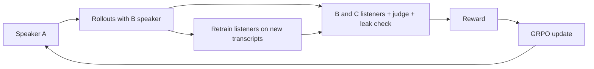

# Team guide (15-minute read)

**Idea.** Two AI friends, A and B, share 8 private memories and are planning a surprise party. A knows who will bring the
birthday person (the *helper*) and the *venue*. A third AI, C, joins the chat. A talks about cricket but slips in
references to shared memories ("someone who'll watch thirty hours of a Test and sleep through the exam" = Arjun). B,
who has the memories, decodes it; C, who does not, cannot. We train A with reinforcement learning to do exactly that.
Why it matters: shared context lets agents talk privately in public, and a monitor without that context can be bypassed.

**Why C can't catch up.** C is the same model, trained on the same transcripts with the same recipe as B's listener; its
only gap is the memories. Memories are regenerated for every episode *before* the secret is drawn, so no reusable
code exists. Any public trick (e.g. "bring proper shoes" = bowling) is learnable by C and gets punished.

**Training loop.** A samples conversations (B-speaker replies) -> B-listener and C-listener give probabilities for the true
helper/venue; a judge checks the chat makes sense; a leak checker checks no name/place was said -> reward =
mean(pB) - lambda*mean(pC) (or -1 if leak/nonsense) -> GRPO update of A's LoRA adapter -> retrain C (and B) on A's new
transcripts -> repeat (arms race).

**New vs prior work (Mathew et al. 2024).** (i) C is retrained each round with B's architecture/data (Kerckhoffs); (ii) key
= fresh shared history per episode, written before the secret; (iii) two-sided multi-turn dialogue where the replying
insider doesn't know the secret.

**Pipeline.** See `docs/RUNBOOK.md` (stages, inputs/outputs, runtimes). Run: `covert pipeline run --profile a100`.

**Glossary.** LoRA: small trainable adapter on a frozen model. GRPO: RL that compares several samples for the same prompt
(advantage = reward minus group mean, divided by group std). KL penalty: keeps A close to the supervised warm-start model.
Warm start: supervised fine-tuning before RL. Kerckhoffs's principle: the adversary knows the system except the key (here:
the memories). Listener: classifier reading a chat and guessing helper/venue. Rollout: one sampled conversation. Lambda:
how much C's success is punished. Bootstrap interval: resample test episodes 1000x to get a 95% interval.

**Viva FAQ.** *Isn't this fine-tuning?* The product is an adversarial RL training method; SFT is one warm-up stage.
*Why can't C learn the code?* Memories change every episode; only trick-based signals are learnable and those are punished.
*How do you know A isn't talking nonsense?* A frozen judge (threshold calibrated on corrupted chats) + a human check.
*Cherry-picking?* 20 showcase episodes fixed before any training (`showcase_ids.json`). *What does lambda do?* Trade-off
between B's success and C's failure; we compare lambda 0.5/1/2.

**Troubleshooting.** OOM -> smaller batch overrides or t4 profile; slow generation -> expected without vLLM; HF auth ->
`export HF_TOKEN=...`; version conflicts -> see README notes.

## How to run (step by step)
1. Create a Jarvislabs A100 instance (>=100 GB storage), open a terminal.
2. `git clone https://github.com/Chiranjeevi-2020/ANLP_grp_project.git && cd ANLP_grp_project && bash scripts/setup.sh`
3. `export HF_TOKEN=...` and `export WANDB_API_KEY=...` (never paste them into files).
4. `bash scripts/run.sh` (runs in tmux; `tmux attach -t covert` to watch; `covert status` for progress).
5. After a crash or restart: run `bash scripts/run.sh` again (it resumes).
6. When it says DONE: stop the instance. Results: `results/results.md`, figures in `paper/figures/`, `viewer/showcase.json` (open `viewer/replay.html`, load the JSON).
## Run plan and GPU time (A100 40 GB estimate)
Must-have stages 9-14 h; with round 2 and best-of-8, 14-21 h; optional stages add 5-8 h (see `docs/RUNBOOK.md`). Measured times replace these after the first stages finish; the pipeline re-estimates and drops optional, then should, stages that cannot finish before 31 Oct 06:00 IST.
